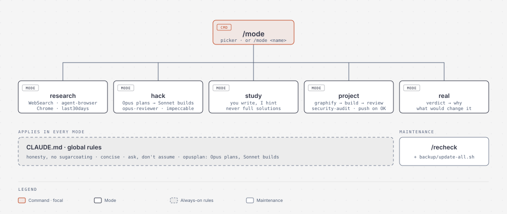

# claude-code-setup

A lean, opinionated [Claude Code](https://claude.com/claude-code) setup: one `/mode` command that switches between five ways of working, a no-sugarcoating master prompt, a hand-picked set of plugins that don't fight each other, and one script that backs up and updates all of them.

<picture>
  <source media="(prefers-color-scheme: dark)" srcset="assets/workflow-dark.svg">
  
</picture>

## Why

The plugin ecosystem is huge, and most "install these 40 plugins" lists make things worse: every enabled plugin loads into every session, and workflow frameworks (ECC, Superpowers, gstack…) give Claude conflicting rules. This setup picks **one tool per job** and puts the workflow in small, on-demand mode files instead.

## Modes

Type `/mode` for a picker, or `/mode <name>` directly. Only the chosen mode's instructions are loaded.

| Mode | What it does |
|---|---|
| `research` | Asks for your context first, then researches with live examples, case studies, dated numbers, sources and counter-evidence. Not just code: studies abroad, careers, startup ideas. |
| `hack` | Hackathon flow: Opus plans in plan mode → Sonnet builds → `opus-reviewer` reviews. UI-first, scope cut to fit the time. |
| `study` | "Code with Claude": you write the code, Claude mentors with hints and questions. **Never writes the solution.** |
| `project` | Serious GitHub work: maps the repo with Graphify first, follows existing conventions, reviews + security-audits before anything is pushed, never pushes without asking. |
| `real` | Brutal honesty: verdict first, then why, then what would change it. Scores don't drop just because you ask "be realistic". |

The global rules in [`claude/CLAUDE.md`](claude/CLAUDE.md) apply in every mode: honest verdicts that only move on new evidence, concise answers, ask instead of assuming, `opusplan` (Opus plans, Sonnet implements).

## What gets installed

| Tool | Job | Source |
|---|---|---|
| Ponytail | Minimal-code, token-lean workflow (the one framework) | [DietrichGebert/ponytail](https://github.com/DietrichGebert/ponytail) |
| Graphify | Codebase → queryable knowledge graph | [Graphify-Labs/graphify](https://github.com/Graphify-Labs/graphify) |
| agent-browser | Headless browser CLI, cheap in tokens | [vercel-labs/agent-browser](https://github.com/vercel-labs/agent-browser) |
| last30days | What Reddit / HN / GitHub say right now (free sources need no key) | [mvanhorn/last30days-skill](https://github.com/mvanhorn/last30days-skill) |
| security-audit | Codebase security audit skill | [cloudflare/security-audit-skill](https://github.com/cloudflare/security-audit-skill) |
| frontend-design + Impeccable | New UI, then audit/polish it | [anthropics/claude-plugins-official](https://github.com/anthropics/claude-plugins-official), [pbakaus/impeccable](https://github.com/pbakaus/impeccable) |
| diagram-design | Diagrams as HTML/SVG (made the image above) | [cathrynlavery/diagram-design](https://github.com/cathrynlavery/diagram-design) |
| brag + Hyperframes | Turn a project into a launch video | [latent-spaces/brag](https://github.com/latent-spaces/brag), [heygen-com/hyperframes](https://github.com/heygen-com/hyperframes) |
| REA *(optional)* | Reverse-engineering MCP server | [morluto/rea](https://github.com/morluto/rea) |

Plus three things written for this setup: the `/mode` skill, the `/recheck` skill, and the `opus-reviewer` agent.

## Setup

**Requirements:** Claude Code, `git`, `python3`, Node.js (`npm`/`npx`) and [`pipx`](https://pipx.pypa.io). Tested on Linux (CachyOS). If `npm install -g` needs `sudo` on your system, set a user prefix first: `npm config set prefix ~/.local/share/npm`.

```bash
git clone https://github.com/Hrushikesh-Mysore/claude-code-setup.git
cd claude-code-setup
./install.sh
```

Options:

| Flag | Effect |
|---|---|
| `--config-only` | Only CLAUDE.md, `/mode`, `/recheck`, `opus-reviewer`, settings. No plugins or tools. |
| `--with-rea` | Also add the REA MCP server (user scope). |
| `--clone-backups` | Also clone every tool repo into `~/backup/repos` (about 2.5 GB). |

Environment overrides: `CLAUDE_CONFIG_DIR` (default `~/.claude`), `BACKUP_DIR` (default `~/backup`).

What the installer does:

1. Saves your current `CLAUDE.md`, `settings.json` and any same-named skills to `~/.claude/backups/pre-claude-code-setup-<date>/`.
2. Adds the master prompt to the top of `~/.claude/CLAUDE.md`, keeping what was there. Re-running replaces only its own section.
3. Copies `/mode`, `/recheck` and `opus-reviewer`; sets `model: opusplan`, `permissions.defaultMode: auto` and empty `attribution` (no `Co-Authored-By: Claude` in commits or PRs) in `settings.json`.
4. Installs the plugins, skills and CLIs above, then prints any step that failed. It's safe to re-run.

Then restart Claude Code (or run `/reload-plugins`) and type `/mode`.

### After installing

- **Study mode:** also type `/ponytail off`. Ponytail only switches when you type the command yourself; study rules override it either way.
- **opusplan** uses Opus only inside plan mode (Shift+Tab). Outside it you're on Sonnet. CLAUDE.md tells Claude to remind you when the model doesn't fit the task.
- **Auto mode** runs commands without prompting but blocks clearly destructive actions. Claude still asks before pushing, publishing or deleting your files.

## Keeping it up to date

```bash
~/backup/update-all.sh --check    # report what's new, change nothing
~/backup/update-all.sh            # back up repos, then update everything
~/backup/update-all.sh --backup   # only refresh the local repo copies
```

It fast-forwards each local repo copy in `~/backup/repos` (listed in `~/backup/repos.txt`), then updates Claude Code, plugins, skills, agent-browser, Graphify, Impeccable and REA. If a repo disappears upstream, your copy is left alone; if its history is rewritten, the old history is kept in a `pre-rewrite-<date>` branch. Every run writes a log to `~/backup/logs/`.

> **Supply-chain warning:** updating everything at once means a compromised upstream repo gets installed immediately. Run `--check` first and read the new commits it lists.

### Whole-machine updater (personal)

[`extras/update.sh`](extras/update.sh) is the one-command updater I run as `update`: AI CLIs (Claude Code, Codex, agy, agent-browser, pipx tools, then `update-all.sh`), AppImage IDEs (Orca, ArtCraft, GitHub Copilot app; sha256-verified against the GitHub release, old copy kept until restart), `paru -Syu`, then orphan/cache cleanup. It is written for **my** machine: Arch/CachyOS, x86_64, and my `~/.local/opt` app paths. Missing tools are skipped, but read it and adjust paths before using it. `install.sh` does not install it.

Inside Claude Code, `/recheck` goes further: it researches every installed tool for deprecations, security advisories and better alternatives, and reports a keep / upgrade / replace table with sources. It never installs anything without your approval.

## Deliberately left out

| Skipped | Why |
|---|---|
| ECC, Superpowers, gstack | Second workflow framework = conflicting rules; ECC alone ships 300+ skills |
| Playwright MCP, Lightpanda | agent-browser does the job with far fewer tokens |
| Firecrawl, Perplexity MCP | Paid API keys; the free stack covers research |
| UI UX Pro Max, Taste, Archify | Overlap with frontend-design / Impeccable / diagram-design |
| Caveman, Headroom, claude-mem | CLAUDE.md concision rule, Claude Code's own compaction and memory cover them |

Need one of them? Add it, then add its repo to `~/backup/repos.txt` so it's backed up too.

## Repo layout

```
claude/CLAUDE.md               master prompt
claude/skills/mode/            /mode picker + one file per mode
claude/skills/recheck/         /recheck
claude/agents/opus-reviewer.md Opus code reviewer
backup/update-all.sh           backup + update everything
backup/repos.txt               repos to back up
extras/update.sh               personal whole-machine updater (Arch, my paths)
assets/workflow.py             regenerates the diagram SVGs
install.sh
```

## Uninstall

Restore the files from `~/.claude/backups/pre-claude-code-setup-<date>/`, delete `~/.claude/skills/mode`, `~/.claude/skills/recheck` and `~/.claude/agents/opus-reviewer.md`, and remove plugins with `claude plugin uninstall <name>`.

## License

[MIT](LICENSE). The installed tools have their own licenses.
